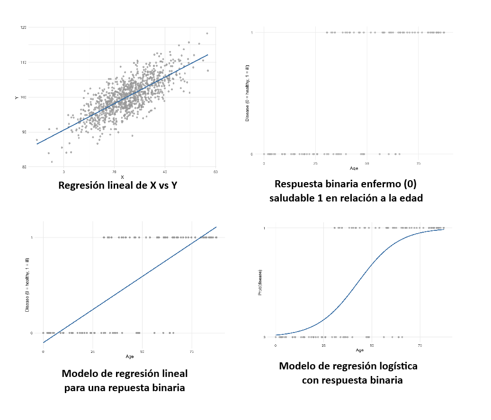
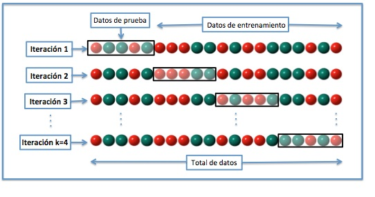

Se utiliza  para predecir la probabilidad de un resultado binario (dos posibles resultados, como “sí” o “no”, “1” o “0”) basado en uno o más predictores, que pueden ser variables continuas o categóricas.


**Variable Dependiente Binaria:** Variable binaria con dos categorías.

**Variables Independientes:** Puede incluir múltiples predictores, pueden ser tanto continuas como categóricas.

No se modela directamente el resultado (ausencia/presencia de la enfermedad), sino la probabilidad de que un paciente la padezca o no, dadas sus características.La clasificación o asignación a una de las categorías depende del límite o threshold que se establezca.

$$P(Y=k|X=x)$$

**Función Logística:** Utiliza la función logística para modelar la probabilidad de que la variable dependiente tome un valor específico (por ejemplo, “1”).


$$p(x)=\frac{e^{\beta_0+\beta_1X}}{1+e^{\beta_0+\beta_1X}}$$
estafunción produce una curva en forma de S, comprendiendo los valores de Y entre o y 1, la ecuación anterior puede escribirse como

$$\frac{p(x)}{1-p(x)}=e^{\beta_0+\beta_1X}$$
Donde $\frac{p(x)}{1-p(x)}$ corresponde al odds ratio pudiendo tomar cualquier valor entre 0 y 1 

si aplicamos logaritmo a ambos lados obtenemos una función lineal 

$$log \left(\frac{p(x)}{1-p(x)}\right)=\beta_0+\beta_1X$$

**Aplicaciones**

- Determinar si un préstamo se aprueba o no en función de predictores como la cantidad de ahorros, los ingresos y la puntuación crediticia

- predecir si un correo electrónico es spam o no 

- si un tumor es maligno o no.

## Tipos de regresión logística.

**Binaria** Estima la relación entre una variable dependiente binaria (dos resultados) y una o más variables independientes (de cualquier tipo).

**Multinomial** Estima la relación entre una variable dependiente nominal con tres o más resultados ordenados o no y una o más variables independientes (de cualquier tipo).


**ejemplos mediante el diagrama de dispersión**

```{r echo=F, fig.asp=2, fig.align='center'}

```


## Datos de entrenamiento y datos de prueba

La división se usa en cualquier modelo predictivo basado en datos como:

- Regresión logística, 
- Algoritmos de machine learning 
- Redes neuronales de deep learning, 
- Modelos estadísticos y series de tiempo. 


```{r echo=F, fig.asp=1, fig.align='center'}

```

**Conjunto de Entrenamiento (Train Set)**


Es la porción con la que el modelo "aprende". El modelo ve estos datos directamente durante el proceso de optimización.El algoritmo analiza los datos de entrada y sus etiquetas (en aprendizaje supervisado) para ajustar sus parámetros internos y pesos.

- Porcentaje habitual: 70% al 80% del total de datos.

**Conjunto de Validación (Validation Set)**

- Porcentaje habitual: 10% al 15% del total de datos.

- Se utiliza de forma intermitente para comparar diferentes variantes o arquitecturas de modelos. Ayuda a detectar y prevenir el sobreajuste (overfitting) mediante técnicas como la detención temprana (early stopping).

- Aunque el modelo no se "entrena" directamente con estos datos, sí influyen indirectamente en las decisiones que toma el desarrollador para elegir cuál es el mejor modelo.

**Conjunto de Prueba (Test Set)**

- Porcentaje habitual: 10% al 15% del total de datos.

- Es una evaluación final, ciega e imparcial. Mide qué tan bien es capaz de generalizar el modelo elegido cuando se enfrenta a datos totalmente nuevos que jamás ha procesado antes.

- Debe mantenerse estrictamente oculto hasta el final del proyecto. Si usas el conjunto de prueba para modificar o reajustar el modelo, contaminas la evaluación y pierdes la objetividad sobre su rendimiento real.

**Proporciones comunes y alternativas**

- Estándar (70 / 15 / 15) o (80 / 10 / 10) para conjuntos de datos grandes.

- Validación cruzada (Cross-Validation, ej. K-Fold): Se recomienda especialmente cuando tienes datasets pequeños, ya que divide los datos en K partes para rotar el rol de entrenamiento y validación y aprovechar al máximo la información disponible sin desperdiciar muestras.

- Series de tiempo: En datos temporales no se debe mezclar ni dividir de forma aleatoria; se debe respetar el orden cronológico estricto (ej. entrenar con el pasado, validar con el presente intermedio y probar con el futuro) para evitar fugas de información (data leakage).


**Matriz de confusión**

Tabla que muestra el rendimiento de un modelo de clasificación al comparar sus predicciones contra los valores reales. Se aplica exactamente sobre los conjuntos de validación y prueba para descubrir en qué categorías acierta el algoritmo y en cuáles se equivoca.


|	Predicción: |Positivo (1)	| Negativo (0)|
|:------------|:-----------:|:-----------:|
|Realidad: Positivo (1)|Verdadero Positivo (VP): Acierto al detectar el caso positivo.	|Falso Negativo (FN): no detectó el caso|
|Realidad: Negativo (0)|Falso Positivo (FP): Falsa alarma (predijo positivo pero era negativo)|Verdadero Negativo (VN): Acierto al descartar el caso negativo.|


**Ejemplo**

El conjunto de datos Uso e impacto de la IA en estudiantes y profesionales se centra en comprender cómo las personas utilizan las herramientas de IA en educación, trabajo y actividades diarias. 

El conjunto de datos incluye tanto a estudiantes como a profesionales, lo que nos permite comparar sus patrones de uso de la IA y comprender cómo la IA afecta a diferentes grupos de usuarios.

**Variables**


|Variables|   |Variable       |Niveles                                    |
|:--------|:-:|:--------------|:------------------------------------------|
|País     |   |Profesión      |estudiante y profesional                   |
|edad     |   |nivel educativo|                                           |
|Ingresos |   |tipo de usuario|                                           |  
|         |   |herramientas de IA|ChatGPT, Gemini, Claude, Copilot y otras|
|         |   |propósito principal para el que se utiliza la IA|          |
|Genero   |   |Horas de uso de IA                              |          |
|         |   |Productivity_Score                              |          |
|         |   |Accuracy_Rating                                 |          | 
|         |   |Satisfaction_Score                              |          |  
|         |   |Time_Saved_Hours_Per_Week                       |          |
|         |   |AI_Experience_Years                             |          |


Se ha creado la variable binaria uso de chat gpt como 1, y 0 en otro caso de usar otra IA, 

```{r cargar-datos}
# Dirección de descarga del dataset
url <- paste0(
  "https://www.kaggle.com/api/v1/datasets/download/",
  "eishatuzzuhra/ai-usage-and-impact-on-students-and-professionals"
)

# Descargar a un archivo temporal
archivo_zip <- tempfile(fileext = ".zip")
download.file(url, archivo_zip, mode = "wb")

# Identificar los archivos CSV del dataset
contenido <- unzip(archivo_zip, list = TRUE)
archivos_csv <- contenido$Name[
  grepl("\\.csv$", contenido$Name, ignore.case = TRUE)
]

if (length(archivos_csv) != 1L) {
  print(contenido$Name)
  stop("Se esperaba un CSV. Revisa la lista de archivos del dataset.")
}

# Leer el CSV desde el ZIP
conexion <- unz(archivo_zip, archivos_csv[1])
datos <- read.csv(conexion, stringsAsFactors = FALSE)


# Eliminar la variable Tasks_Performed
datos$Tasks_Performed <- NULL
datos$User_ID=NULL


```

```{r}


# Crear variable categórica: ChatGPT = 1; otras IA = 0
datos$Uso_ChatGPT <- factor(
  ifelse(
    tolower(trimws(datos$AI_Tool)) == "chatgpt",
    1,
    0
  ),
  levels = c(0, 1)
)

# Verificar los resultados
table(datos$Uso_ChatGPT, useNA = "ifany")
str(datos$Uso_ChatGPT)
head(datos)
```

se quiere determinar la probabilidad o riesgo de que cada uno de los usuarios hagan uso de Chat gpt, tratemos de ajustar un modelo de regresión lineal


```{r}
library(ggplot2)

bas <- data.frame(
  Uso_ChatGPT = datos$Uso_ChatGPT,
  costo = as.character(datos$Monthly_AI_Cost)
)

# Quitar el signo $ y los espacios de los extremos
bas$costo <- trimws(gsub("$", "", bas$costo, fixed = TRUE))

# Eliminar filas sin costo
bas <- bas[!is.na(bas$costo) & bas$costo != "", ]

# Convertir costo a número
bas$costo <- as.numeric(bas$costo)

## modelo logistico
modelo_logistico <- glm(
  Uso_ChatGPT ~ as.numeric(costo),
  data = bas,
  family = binomial(link = "logit"))

summary(modelo_logistico)


# Valores de costo para dibujar la curva
curva <- data.frame(
  costo = seq(
    min(bas$costo, na.rm = TRUE),
    max(bas$costo, na.rm = TRUE),
    length.out = 200
  )
)

curva$probabilidad <- predict(
  modelo_logistico,
  newdata = curva,
  type = "response"
)

# Gráfico
ggplot(bas, aes(x = costo)) +
  geom_point(
    aes(
      y = as.numeric(as.character(Uso_ChatGPT)),
      color = Uso_ChatGPT
    ),
    shape = 1,
    alpha = 0.5
  ) +
  geom_line(
    data = curva,
    aes(y = probabilidad),
    color = "blue",
    linewidth = 1
  ) +
  theme_bw() +
  labs(
    title = "Regresión logística: uso de ChatGPT según el costo",
    x = "Costo mensual de IA",
    y = "Probabilidad de usar ChatGPT"
  ) +
  theme(legend.position = "none")

```

